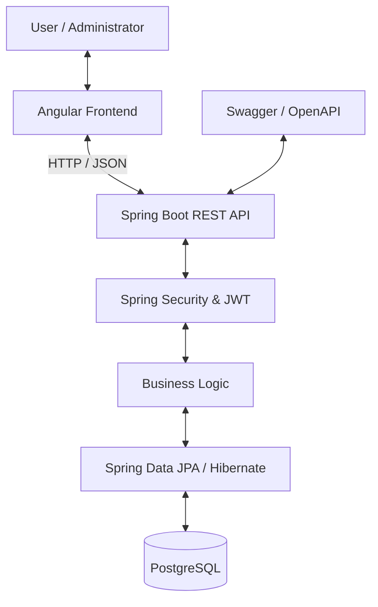
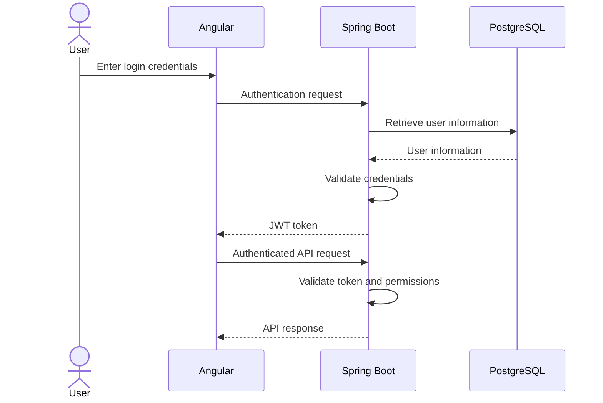

<div align="center">


[](https://deepwiki.com/ProGencel/TimeSheetApp)

**A full-stack application for tracking work hours, managing projects, and monitoring team productivity.**

[Overview](#overview) •
[Features](#features) •
[Tech Stack](#tech-stack) •
[Architecture](#architecture) •
[Getting Started](#getting-started) •
[API Documentation](#api-documentation)

</div>

---

## Overview

**TimeSheetApp** is a full-stack time tracking and project management application built with Java, Spring Boot, and Angular.

The application allows users to record their working hours, associate timesheet entries with projects, and monitor their weekly activity.

Administrators have access to a centralized management panel for overseeing users, projects, timesheet records, and project analytics.

The project brings together REST API development, authentication, authorization, relational database management, and modern frontend development in a single application.

## Features

### User Management & Time Tracking

| Feature | Description |
| :--- | :--- |
| Authentication | User registration and login with JWT-based authentication. |
| Timesheet Management | Create, view, update, and list personal timesheet entries. |
| Date Filtering | Filter timesheets within a specified date range. |
| Weekly Summary | View total working hours for the current week. |
| Project Association | Associate working hours with specific projects. |
| Data Export | Export personal timesheet records to CSV or Excel. |

### Administration

| Feature | Description |
| :--- | :--- |
| Admin Dashboard | Centralized access to administrative functionality. |
| User Search | Find users by username or email address. |
| Timesheet Oversight | Search timesheet records by username and date range. |
| Project Analytics | View the top three projects ranked by recorded work hours. |
| User Activity | Monitor weekly working hours for individual users. |
| Data Export | Export user and timesheet records to CSV or Excel. |

### Project Management

| Feature | Description |
| :--- | :--- |
| Project Creation | Create projects with a name and description. |
| Member Assignment | Assign users to relevant projects. |
| Time Tracking | Associate timesheet entries with projects. |
| Project Lifecycle | Allow project owners to mark projects as finished. |

---

## Tech Stack

### Backend

<div align="center">

[](https://skillicons.dev)

</div>

| Technology | Purpose |
| :--- | :--- |
| Java 17 | Backend programming language |
| Spring Boot 4.1 | Application framework |
| Spring Web MVC | REST API development |
| Spring Security | Authentication and authorization |
| JSON Web Tokens | Token-based authentication |
| Spring Data JPA | Data access and persistence |
| Hibernate | Object-relational mapping |
| PostgreSQL | Relational database |
| ModelMapper | Object and DTO mapping |
| jBCrypt | Password hashing |
| Apache POI | Excel file generation |
| Lombok | Boilerplate code reduction |
| Springdoc OpenAPI | Interactive API documentation |
| Maven | Dependency management and build automation |

### Frontend

<div align="center">

[](https://skillicons.dev)

</div>

| Technology | Purpose |
| :--- | :--- |
| Angular 21 | Frontend application framework |
| TypeScript | Type-safe frontend development |
| RxJS | Reactive programming |
| Tailwind CSS 4 | Utility-first styling |
| daisyUI 5 | UI component library |
| npm | Package management |

### Development Tools

<div align="center">


</div>

---

## Architecture

TimeSheetApp follows a client-server architecture, separating the frontend application, backend REST API, and relational database.



### Repository Structure

```text
TimeSheetApp/
│
├── Backend/
│   ├── src/
│   │   ├── main/
│   │   │   ├── java/
│   │   │   └── resources/
│   │   │       └── application.properties
│   │   └── test/
│   └── pom.xml
│
├── Frontend/
│   ├── src/
│   ├── angular.json
│   └── package.json
│
├── .gitignore
├── LICENSE
└── README.md
```

---

## Getting Started

Follow the instructions below to run the application locally.

### Prerequisites

Make sure the following tools are installed:

| Requirement | Version |
| :--- | :--- |
| Java Development Kit | 17 or later |
| Node.js | 22.12+ within Node 22, or Node 24 |
| npm | Compatible with the installed Node.js version |
| PostgreSQL | A running database instance |
| Git | Latest stable version |
| Maven | Optional if using the Maven Wrapper |

### 1. Clone the Repository

```bash
git clone https://github.com/ProGencel/TimeSheetApp.git
cd TimeSheetApp
```

### 2. Configure the Database

Create a PostgreSQL database:

```sql
CREATE DATABASE timesheet;
```

Navigate to the backend configuration file:

```text
Backend/src/main/resources/application.properties
```

The repository currently contains a configuration for a hosted PostgreSQL database. To use your own local database, replace the datasource settings with:

```properties
spring.datasource.url=jdbc:postgresql://localhost:5432/timesheet
spring.datasource.username=postgres
spring.datasource.password=${DB_PASSWORD}

spring.jpa.hibernate.ddl-auto=update

jwt.secret=${JWT_KEY}
jwt.expiration=86400000
```

Adjust the database username if necessary.

### 3. Configure Environment Variables

The application uses environment variables for sensitive configuration.

| Variable | Description |
| :--- | :--- |
| `DB_PASSWORD` | PostgreSQL database password |
| `JWT_KEY` | Secure JWT signing secret |

#### Windows — PowerShell

```powershell
$env:DB_PASSWORD="your_database_password"
$env:JWT_KEY="your_secure_jwt_signing_key"
```

#### Linux / macOS

```bash
export DB_PASSWORD="your_database_password"
export JWT_KEY="your_secure_jwt_signing_key"
```

Replace the example JWT key with a cryptographically secure key in the format expected by the application's JWT implementation.

> [!IMPORTANT]
> Never commit real database credentials, JWT secrets, or other sensitive information to version control.

### 4. Start the Backend

Navigate to the backend directory:

```bash
cd Backend
```

#### Windows

```powershell
.\mvnw.cmd spring-boot:run
```

#### Linux / macOS

```bash
./mvnw spring-boot:run
```

Alternatively, if Maven is installed globally:

```bash
mvn spring-boot:run
```

The backend will be available at:

**http://localhost:8080**

### 5. Start the Frontend

Open a new terminal in the repository root.

```bash
cd Frontend
npm install
npm start
```

The frontend will be available at:

**http://localhost:4200**

> [!NOTE]
> Both the frontend and backend must be running to use the application.

---

## API Documentation

The backend uses Springdoc OpenAPI to provide interactive REST API documentation.

Once the backend is running, open:

| Service | URL |
| :--- | :--- |
| Swagger UI | [localhost:8080/swagger-ui.html](http://localhost:8080/swagger-ui.html) |
| OpenAPI JSON | [localhost:8080/v3/api-docs](http://localhost:8080/v3/api-docs) |
| Frontend | [localhost:4200](http://localhost:4200) |

Swagger UI allows developers to:

- Explore available REST API endpoints.
- Inspect request and response models.
- Test API requests directly from the browser.
- Review endpoint parameters.

Authentication may be required for protected endpoints.

---

## Authentication & Authorization

TimeSheetApp uses Spring Security and JSON Web Tokens for authentication and access control.



The application includes:

- JWT-based authentication.
- Password hashing with BCrypt.
- User and administrator access control.
- Protected backend operations.
- Environment-based secret configuration.

---

## Building the Application

### Backend

```bash
cd Backend
mvn clean package
```

### Frontend

```bash
cd Frontend
npm install
npm run build
```

Angular generates the production build inside its configured `dist` directory.

---

## Testing

### Backend

```bash
cd Backend
mvn test
```

### Frontend

```bash
cd Frontend
npm test
```

---

## Author

**Ahmet Efe Gencel**

[](https://github.com/ProGencel)
[](https://progencel.github.io/)

<div align="center">

If you find this project useful, consider giving it a star.


</div>
